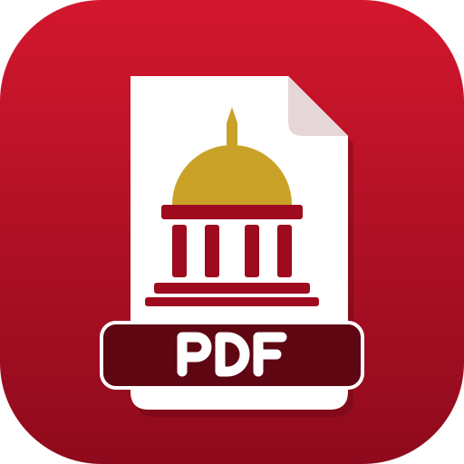

# ShuraPDF app icon



**Motif:** a white PDF page (folded top-right corner) carrying a council chamber, a gold dome with a
spire over a red drum, four columns and two steps, with a dark red "PDF" label across the foot of the page.

**Style:** flat geometric shapes only: no fonts (the "PDF" letters are stroked paths), no traced or
third-party images, so it renders the same everywhere.

**Palette:**

| Colour | Hex | Used for |
|---|---|---|
| Red field | `#d3172e` → `#8e0a1c` (top to bottom) | the full-bleed tile, close to the red of Bahrain's flag |
| Paper | `#ffffff`, fold `#e7d6d8` | the page |
| Gold | `#c9a227` | dome and spire |
| Deep red | `#9e0b1f`, label `#5e0612` | chamber and label |

**Tile:** `viewBox="0 0 512 512"`, a rounded square with `rx=112` that clips everything, as upstream's.

**Provenance:** drawn by hand in SVG for this fork (general07z/shurapdf, 2026-10-30); it replaces
upstream's lion. It is not the Shura Council's emblem: an official emblem is a government mark, so it
stays out of this public repository. Licence: [LICENSE.txt](LICENSE.txt) (`MIT OR Apache-2.0`).

**The official emblem in a private build:** ICT can keep a private copy of the repository, replace
`pdfcraft.svg` with artwork that uses the emblem (with the Council's permission), regenerate the files
below and build there. Never commit the emblem here.

The file names keep "pdfcraft" so that the build, the installer and the Linux desktop entry need no change.

## Files

| File | What it is |
|---|---|
| `pdfcraft.svg` | the master vector; every PNG, `.ico` and `.icns` is rendered from it |
| `pdfcraft-small.svg` | the same vector (upstream keeps a lighter trace here), for this README |
| `pdfcraft-1024.png` | 1024 px on Apple's grid; also the runtime Dock icon on macOS |
| `pdfcraft.icns` | macOS icon (16–1024 px) |
| `pdfcraft.ico` | Windows icon (16–256 px), embedded in `pdfcraft.exe` by `apps/pdfcraft/build.rs` |
| `pdfcraft-document.svg` | Windows PDF file icon master: a Lucide document outline, red badge and outlined PDF lettering; no font dependency |
| `pdfcraft-document.ico` | Windows PDF file icon (16–256 px), embedded as resource 2 in `pdfcraft.exe` |
| `hicolor/<n>x<n>/apps/ai.storyteller.pdfcraft.png` | Linux hicolor theme, 16–512 px; the 256 px one is the runtime icon on Windows and Linux |
| `hicolor/scalable/apps/ai.storyteller.pdfcraft.svg` | Linux scalable icon (copy of the master) |

Where it shows: `apps/pdfcraft/src/main.rs` sets the window icon (Dock, taskbar, Alt-Tab, launcher) and the
Wayland app id `ai.storyteller.pdfcraft`; `packaging/linux/ai.storyteller.pdfcraft.desktop` names the
hicolor icon.

Windows PDF files use resource 2 (`"pdfcraft.exe",-2`) when PdfCraft is chosen as the default
reader; the app keeps resource 1. The document outline is adapted from Lucide `file-text`
1.49.0 (ISC); its badge and outlined lettering are original (`MIT OR Apache-2.0`), covered by
[LICENSE-document.txt](LICENSE-document.txt). Both icons are embedded, requiring no runtime
sidecar. This provides a file type icon; first-page thumbnails still need a thumbnail provider.

## Regenerate

```sh
packaging/icons.sh        # needs resvg and python3; iconutil (macOS) for the .icns
cargo xtask assets        # then update the sha256 values in ATTRIBUTION.toml and run with --write
```
